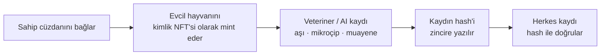

# 🐾 Rialo PetVerse RWA

🇹🇷 Türkçe · 🇬🇧 [English](#english)

**Evcil hayvanlar için zincir üstü dijital kimlik platformu.**
Sahipler evcil hayvanlarını NFT olarak mint eder; aşı, mikroçip ve veteriner kayıtları zincire **kanıt hash'i** olarak yazılır. Böylece hayvanın sağlık geçmişi değiştirilemez ve herkes tarafından doğrulanabilir hâle gelir — gerçek dünyadaki bir varlığın (RWA) zincir üstü karşılığı.

🔗 **Canlı site:** https://cagdasozsahin.github.io/rialo-petverse-rwa/

> ⚠️ Proje şu anda **Ethereum Sepolia test ağında** çalışır. Tokenlar test amaçlıdır, gerçek değeri yoktur. Sözleşmeler bağımsız bir güvenlik denetiminden geçmemiştir.

---

## Nasıl çalışır?

1. **Cüzdanı bağla** — MetaMask ile Sepolia ağına bağlan.
2. **Kimlik NFT'si oluştur** — Evcil hayvanın adı, türü ve fotoğrafıyla benzersiz bir dijital kimlik NFT'si mint edilir.
3. **Kayıt ekle** — Aşı, mikroçip ya da veteriner muayenesi gibi kayıtlar eklenir.
4. **Kanıtı zincire yaz** — Kaydın kendisi değil, **hash'i** zincire yazılır; kişisel veri açığa çıkmaz ama kayıt sonradan değiştirilirse hash tutmaz.
5. **Doğrula** — Sahiplik değişiminde, sigortada ya da seyahatte kayıt hash'iyle doğrulanır.

---

## Özellikler

- 🐶 **Pet kimlik NFT'leri** — Her evcil hayvan için benzersiz, sahibine bağlı dijital kimlik.
- 🩺 **Doğrulanabilir sağlık kayıtları** — Veteriner veya AI ile doğrulanan kayıtlar zincirde kanıt hash'i olarak saklanır.
- 🔁 **Token swap** — Uniswap V2 tabanlı test havuzlarıyla token takası.
- 📈 **Staking** — Tokenlarını stake ederek ödül kazan.
- 🪙 **Ekosistem tokenları** — Platform içinde kullanılan test ERC-20 tokenları.

---

## Neden RWA?

Evcil hayvanlar gerçek dünyada sahiplik, sağlık ve sigorta kayıtları olan varlıklardır. Bugün bu kayıtlar kâğıtta ya da kapalı sistemlerde durur ve kolayca kaybolur veya değiştirilir. PetVerse bu kayıtları:

- **değiştirilemez** (hash zincirde),
- **taşınabilir** (NFT sahibiyle birlikte el değiştirir),
- **doğrulanabilir** (veteriner, sigorta, barınak, alıcı herkes kontrol edebilir)

hâle getirir.

---

## Yol haritası: Rialo'ya geçiş

| Rialo özelliği | PetVerse'te planlanan kullanım |
| --- | --- |
| **REX** | Aşı, mikroçip ve sigorta kayıtlarını dış kaynaklardan (veteriner sistemleri, mikroçip veritabanları) gizlilik korunarak doğrulamak; sonucu zincire kanıt olarak yazmak. |
| **Latch** | Kayıt doğrulamasında kullanılan AI / API anahtarlarını şifreli tutmak; anahtarı açığa çıkarmadan doğrulama yapmak. |
| **Reactive transactions** | Aşı tarihi yaklaşınca hatırlatma, süresi dolan sigorta için otomatik durum güncellemesi. |
| **Yerel RLO** | Swap ve staking'in RLO ile çalışması. |

> Bu bölüm planlanan geliştirmeleri anlatır; şu anki sürüm Sepolia üzerindedir.

---

## Nasıl denerim?

1. MetaMask'ı kur ve **Sepolia** ağına geç.
2. Bir faucet'ten test Sepolia ETH al.
3. Siteyi aç: https://cagdasozsahin.github.io/rialo-petverse-rwa/
4. Cüzdanını bağla, evcil hayvanının kimlik NFT'sini oluştur ve bir sağlık kaydı ekle.

---

## Teknoloji

- Tek sayfa HTML/JavaScript arayüz (GitHub Pages)
- Solidity akıllı sözleşmeleri (Remix ile Sepolia'ya dağıtıldı)
- MetaMask cüzdan bağlantısı
- Uniswap V2 tabanlı swap havuzları

---

## 🇬🇧 English

**Rialo PetVerse RWA** is an on-chain digital identity platform for pets. Owners mint their pets as NFTs, and vaccination, microchip and vet records are written on-chain as **proof hashes**, making a pet's health history tamper-proof and publicly verifiable — a real-world asset (RWA) with an on-chain twin.

**How it works:** connect MetaMask (Sepolia) → mint a pet identity NFT → add a vet or AI-verified record → its hash is stored on-chain → anyone can verify the record against the hash.

**Features:** pet identity NFTs · verifiable health records · Uniswap V2–based token swap · staking · test ERC-20 ecosystem tokens.

**Roadmap on Rialo:** **REX** to verify vaccine, microchip and insurance records from external sources with privacy, **Latch** to keep verification API/AI keys encrypted, **reactive transactions** for vaccine reminders and insurance expiry, and native **RLO** for swap and staking.

Live: https://cagdasozsahin.github.io/rialo-petverse-rwa/

> ⚠️ Runs on Ethereum Sepolia testnet. Test tokens only; contracts are not audited.
